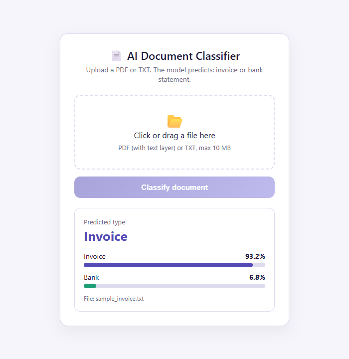

# AI Document Classifier

A Flask web app that classifies uploaded documents as **invoice** or **bank statement** using TF-IDF features and Logistic Regression. It's the first step of an Intelligent Document Processing (IDP) pipeline: the document type is identified before routing to the right extraction logic.

  



## How it works

```
PDF / TXT  →  text extraction (PyPDF2)  →  TF-IDF (word 1-2 grams)  →  Logistic Regression  →  label + confidence
```

- **Text extraction**: `utils.py` reads the text layer of PDFs (PyPDF2) or plain `.txt` files.
- **Features**: TF-IDF on unigrams and bigrams, English stop words removed. The tokenizer keeps **words only** and ignores numbers, so account numbers, amounts and IDs never end up in the saved model.
- **Model**: Logistic Regression, which gives a probability for each class (shown as confidence in the UI).
- **Privacy**: uploads go to a temporary file and are deleted right after classification.

## Project structure

| File | Purpose |
|---|---|
| `generate_data.py` | Creates synthetic invoices and bank statements (all names and numbers are fake) |
| `train.py` | Trains the model, prints a test-set report and saves `model.pkl` |
| `predict.py` | Command-line prediction for a single file |
| `app.py` | Flask web app |
| `utils.py` | Text extraction |
| `templates/index.html` | Upload page and results |
| `samples/` | One example of each document type to try |

## Run it

```bash
pip install -r requirements.txt

python app.py              # open http://127.0.0.1:5000 and upload a file from samples/
```

Command line:

```bash
python predict.py samples/sample_invoice.txt
# Document type: invoice
#   bank     6.8%
#   invoice  93.2%
```

Retrain from scratch:

```bash
python generate_data.py    # 150 invoices + 150 bank statements into data/
python train.py
```

To train on your own documents, put `.pdf` / `.txt` files in `data/`. Any file with `invoice` in its name is labelled *invoice* and the rest *bank*. `data/` is git-ignored, so your documents are never committed.

## Results

On a held-out 20% split of the synthetic data the model scores **100% accuracy** (60 test documents). The two classes use very different vocabulary (*GST, subtotal, bill to* vs *opening balance, debit, credit*), so that's expected. Treat it as a pipeline demo, not a benchmark. Real documents with mixed layouts are harder.

## Limitations and next steps

- Scanned PDFs have no text layer: add OCR (Tesseract / PaddleOCR) before classification.
- Only two classes: extend with purchase orders, receipts, payslips, etc.
- Next stage of the pipeline: field extraction (invoice number, totals, dates) with an LLM, based on the predicted type.
